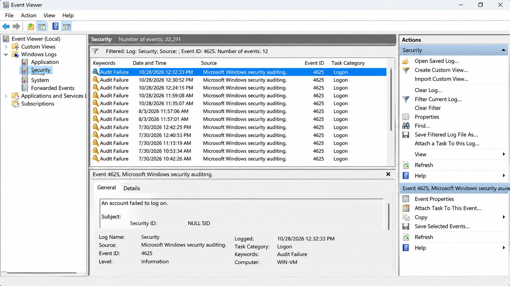
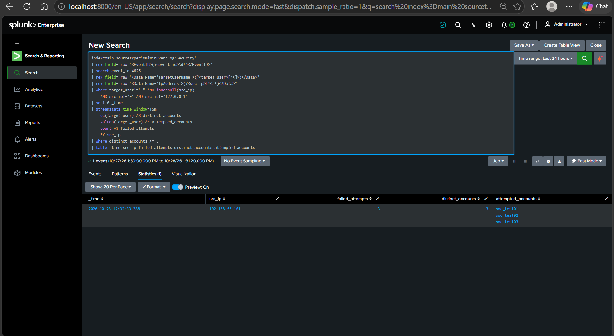
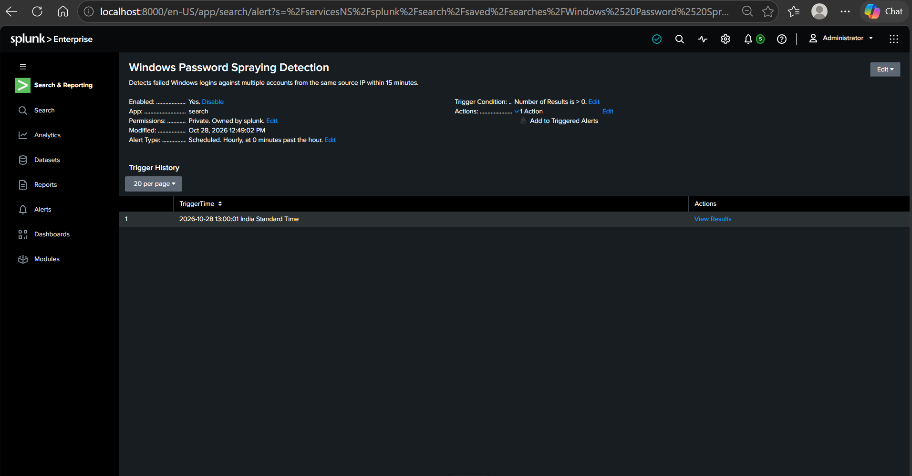
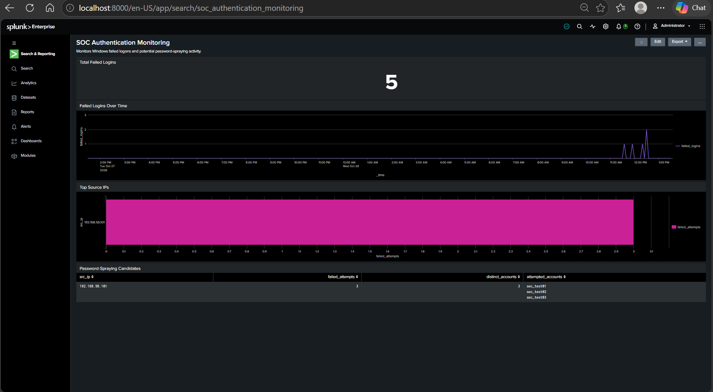

# Splunk Password Spraying Detection Using SIEM

## 1. Project Overview

This project demonstrates how to monitor Windows authentication events and detect suspicious login activity using Splunk Enterprise SIEM.

The project uses Windows Security logs collected through Splunk Universal Forwarder. Custom Splunk Processing Language (SPL) queries analyze failed login attempts and identify source IP addresses attempting to authenticate against multiple user accounts within a defined time window.

A scheduled Splunk alert and an authentication monitoring dashboard are used to demonstrate detection, alerting, and security event monitoring.

**Project Type:** Cybersecurity / SIEM / SOC Analyst L1  
**Platform:** Splunk Enterprise  
**Operating System:** Windows and Kali Linux virtual machines  
**Detection Technique:** Windows failed-logon analysis  
**Windows Event ID:** 4625

---

## 2. Project Objectives

- Collect Windows Security logs in Splunk.
- Monitor failed Windows authentication attempts.
- Analyze Windows Event ID 4625.
- Identify suspicious authentication attempts against multiple accounts.
- Detect potential password-spraying activity using SPL.
- Configure a scheduled alert for suspicious login patterns.
- Create a dashboard for authentication monitoring.
- Validate detection using controlled authentication failures in an isolated lab.

---

## 3. Lab Architecture

The lab consists of three main components.

| Component | IP Address | Purpose |
|---|---|---|
| Splunk Enterprise host | 192.168.56.1 | Collects, searches, and analyzes security logs |
| Kali Linux VM | 192.168.56.101 | Generates controlled failed authentication attempts |
| Windows VM | 192.168.56.102 | Generates Windows Security authentication events |

### Log Collection Flow

```text
┌─────────────────────┐
│   Kali Linux VM     │
│   192.168.56.101    │
└──────────┬──────────┘
           │
           │ Controlled failed
           │ authentication attempts
           ▼
┌─────────────────────┐
│    Windows VM       │
│   192.168.56.102    │
│                     │
│ Security Event 4625 │
└──────────┬──────────┘
           │
           │ Splunk Universal Forwarder
           ▼
┌─────────────────────┐
│ Splunk Enterprise   │
│   192.168.56.1      │
│                     │
│ Search & Detection  │
│ Alerts & Dashboard  │
└─────────────────────┘
```

The virtual machines communicate over an isolated VirtualBox host-only network.

---

## 4. Tools and Technologies

- **Splunk Enterprise:** Log collection, search, analysis, and alerting.
- **Splunk Universal Forwarder:** Forwards Windows Security logs to Splunk.
- **Windows Event Viewer:** Inspects Windows Security events.
- **Kali Linux:** Generates controlled authentication failures for testing.
- **VirtualBox:** Hosts the virtual lab environment.
- **Splunk Processing Language (SPL):** Searches and analyzes authentication events.
- **GitHub:** Documents the project and stores SPL queries and screenshots.

---

## 5. Understanding Windows Event ID 4625

Windows Security Event ID 4625 indicates that an account failed to log on.

Failed logons can occur because of:
- Incorrect passwords.
- Invalid usernames.
- Unauthorized authentication attempts.
- Misconfigured applications or services.
- Automated attempts to access multiple accounts.

A high number of failed logons from one source IP, particularly across several accounts in a short period, can indicate suspicious authentication activity.

However, a failed logon by itself does not establish that an attack occurred.

---

## 6. Password Spraying: Detection Concept

Password spraying is an attack technique in which an attacker attempts a small number of commonly used passwords against multiple user accounts.

The purpose is to avoid triggering account lockout controls that might activate when many passwords are tried against a single account.

For this project, the detection logic looks for:

- Windows failed-logon events (Event ID 4625).
- A common source IP address.
- Multiple distinct usernames.
- Three or more distinct accounts within a 15-minute window.

This pattern is treated as a **potential password-spraying indicator**, not definitive proof of an attack.

---

## 7. SPL Query 1: Failed Logon Analysis

**File:** `spl/failed_logon_analysis.spl`

### Purpose

Searches Windows Security logs for failed logons and displays the event timestamp, hostname, event ID, username, and source IP.

```spl
index=main sourcetype="XmlWinEventLog:Security"
| rex field=_raw "<EventID>(?<event_id>\d+)</EventID>"
| search event_id=4625
| rex field=_raw "<Data Name='TargetUserName'>(?<target_user>[^<]*)</Data>"
| rex field=_raw "<Data Name='IpAddress'>(?<src_ip>[^<]*)</Data>"
| table _time host event_id target_user src_ip
| sort - _time
```

### Expected Result

The query returns failed-logon events with their timestamps, Windows host, account names, and source IP addresses.

---

## 8. SPL Query 2: Password Spraying Detection

**File:** `spl/password_spraying_detection.spl`

### Purpose

Identifies source IP addresses associated with failed authentication attempts against three or more distinct accounts within a rolling 15-minute window.

```spl
index=main sourcetype="XmlWinEventLog:Security"
| rex field=_raw "<EventID>(?<event_id>\d+)</EventID>"
| search event_id=4625
| rex field=_raw "<Data Name='TargetUserName'>(?<target_user>[^<]*)</Data>"
| rex field=_raw "<Data Name='IpAddress'>(?<src_ip>[^<]*)</Data>"
| where target_user!="-" AND isnotnull(src_ip)
    AND src_ip!="-" AND src_ip!="127.0.0.1"
| sort 0 _time
| streamstats time_window=15m
    dc(target_user) AS distinct_accounts
    values(target_user) AS attempted_accounts
    count AS failed_attempts
    BY src_ip
| where distinct_accounts >= 3
| table _time src_ip failed_attempts distinct_accounts attempted_accounts
```

### Detection Logic

1. Searches Windows Security logs.
2. Filters for Event ID 4625.
3. Extracts the attempted username and source IP.
4. Excludes common invalid or loopback source addresses.
5. Groups events by source IP and calculates rolling 15-minute statistics.
6. Counts distinct attempted usernames and failed-logon events.
7. Reports results when at least three distinct accounts are observed.

### Lab Validation Result

During controlled testing, the following pattern was observed:

| Field | Observed Result |
|---|---|
| Source IP | 192.168.56.101 |
| Failed attempts | 3 |
| Distinct accounts | 3 |
| Attempted accounts | soc_test01, soc_test02, soc_test03 |
| Windows Event ID | 4625 |

This confirms that the detection query identified the tested multi-account failed-logon pattern.

**Important:** These results validate the detection logic against the lab activity. They do not independently prove that the same password was used for all accounts or that a real password-spraying attack occurred.

---

## 9. SPL Query 3: Top Source IPs

**File:** `spl/top_source_ips.spl`

### Purpose

Ranks source IP addresses according to their number of failed Windows logons.

```spl
index=main sourcetype="XmlWinEventLog:Security"
| rex field=_raw "<EventID>(?<event_id>\d+)</EventID>"
| search event_id=4625
| rex field=_raw "<Data Name='IpAddress'>(?<src_ip>[^<]*)</Data>"
| where isnotnull(src_ip)
    AND src_ip!="-"
    AND src_ip!="127.0.0.1"
| stats count AS failed_attempts BY src_ip
| sort - failed_attempts
```

### Expected Result

The query returns a table containing source IP addresses and their failed-logon counts, sorted from highest to lowest.

This can help an analyst prioritize source addresses for investigation.

---

## 10. Scheduled Alert Configuration

**Alert Name:** Windows Password Spraying Detection

**Description:** Detects failed Windows logins against multiple accounts from the same source IP within 15 minutes.

| Setting | Configuration |
|---|---|
| Alert type | Scheduled |
| Schedule | Hourly |
| Trigger condition | Number of results greater than 0 |
| Trigger behavior | Once |
| Severity | Medium |
| Action | Add to Triggered Alerts |
| Permissions | Private |
| Status | Enabled |

### Alert Validation

The alert successfully triggered during lab validation on October 28, 2026.

The triggered results showed:
- Source IP: `192.168.56.101`
- Failed attempts: `3`
- Distinct accounts: `3`
- Attempted accounts: `soc_test01`, `soc_test02`, `soc_test03`

### Operational Consideration

The hourly schedule was used for learning and demonstration. An hourly schedule can delay detection and may be unsuitable for time-sensitive monitoring.

In a production environment, an analyst should evaluate the search time range, execution frequency, scheduling behavior, event volume, and alert latency. A more frequent schedule may be appropriate depending on the environment and available resources.

---

## 11. SOC Authentication Monitoring Dashboard

**Dashboard Name:** SOC Authentication Monitoring

The dashboard contains four panels.

### Panel 1: Total Failed Logins

Displays the total number of failed Windows logon events matching the dashboard's search and time range.

### Panel 2: Failed Logins Over Time

Displays changes in failed-logon activity over time to help identify unusual increases.

### Panel 3: Top Source IPs

Highlights source IP addresses associated with the highest numbers of failed logons.

### Panel 4: Password-Spraying Candidates

Displays suspicious multi-account failed-logon patterns identified by the detection search.

The dashboard provides a consolidated view of Windows authentication activity for investigation and monitoring.

---

## 12. Screenshots

The following screenshots document the project and its validation.

### Windows Event ID 4625



### Failed Logon Results


### Password Spraying Detection Results



### Scheduled Alert Configuration




### SOC Authentication Monitoring Dashboard



*Ensure the corresponding image files are uploaded to the `screenshots/` directory. GitHub will display the images when the filenames and paths match.*

---

## 13. Repository Structure

```text
splunk-password-spraying-detection/
│
├── README.md
│
├── spl/
│   ├── failed_logon_analysis.spl
│   ├── password_spraying_detection.spl
│   └── top_source_ips.spl
│
├── screenshots/
│   ├── windows_event_4625.png
│   ├── Failed_logon.png
│   ├── password_spraying_detection.png
│   ├── alert_configuration.png
│   └── Dashboard.png
```

---

## 14. Limitations and Improvements

### Current Limitations

- Detection relies on Windows failed-logon events and source IP addresses.
- The three-account threshold is a demonstration setting and may need tuning.
- Shared IP addresses, NAT, service accounts, and legitimate authentication failures can produce false positives.
- Event fields and XML formats may vary across Windows logging configurations.
- The current alert schedule is hourly and may delay detection.
- Failed-logon telemetry alone cannot prove that an identical password was used across accounts.
- The lab uses a small number of controlled test events and does not represent a large production environment.

### Future Improvements

- Tune thresholds using real environment baselines.
- Correlate failed and successful authentication events.
- Investigate related Windows Security events and relevant endpoint telemetry.
- Add allowlists for known service accounts and trusted systems where appropriate.
- Improve alert scheduling and response workflows.
- Add investigation notes and incident triage steps.
- Integrate the alert with a ticketing or incident management workflow.

---

## 15. Skills Demonstrated

- SIEM monitoring with Splunk Enterprise.
- Windows Security log analysis.
- Windows Event ID 4625 investigation.
- SPL search and field extraction using `rex`.
- Event aggregation using `stats` and `streamstats`.
- Rolling time-window detection.
- Authentication anomaly identification.
- Scheduled alert configuration and validation.
- Dashboard creation and security monitoring.
- Virtual lab setup using VirtualBox.
- Basic SOC L1 investigation and documentation.

---

## 16. Disclaimer

This project was developed for educational purposes in an isolated, authorized virtual lab.

The authentication attempts were generated against a test Windows VM under controlled conditions. This project does not authorize testing against systems, accounts, or networks without permission.

The detection identifies suspicious authentication patterns and should be combined with additional evidence and analyst investigation before classifying activity as a confirmed attack.

---

## Author

**Cybersecurity Project: Splunk Password Spraying Detection**

This project demonstrates practical SIEM monitoring, Windows authentication log analysis, SPL-based detection, scheduled alerting, and dashboard development relevant to entry-level Security Operations Center (SOC) Analyst roles.
